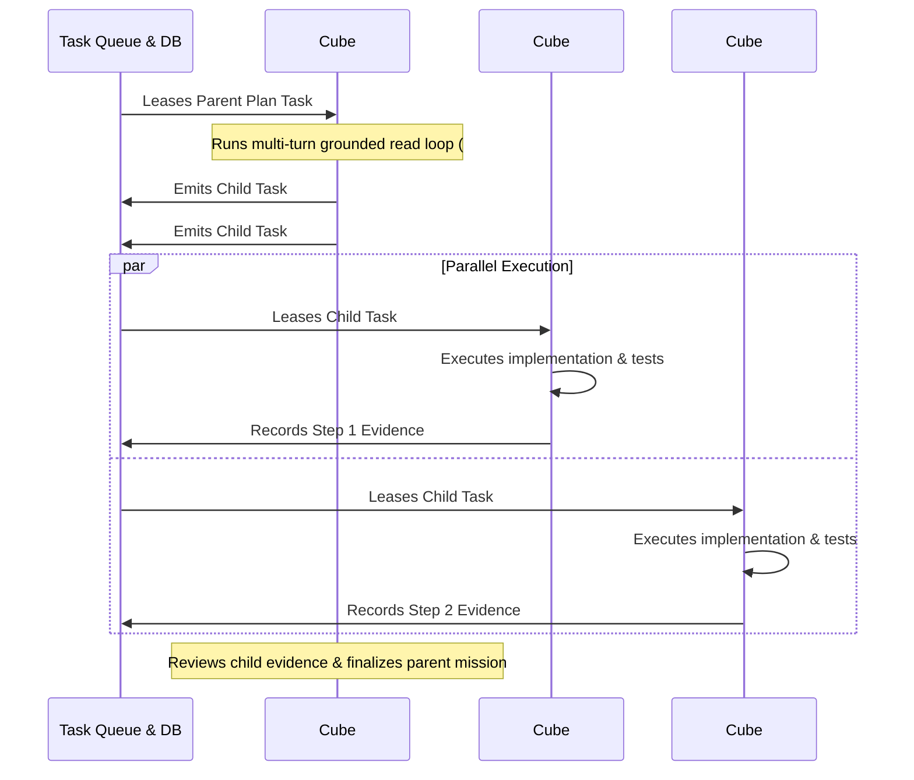
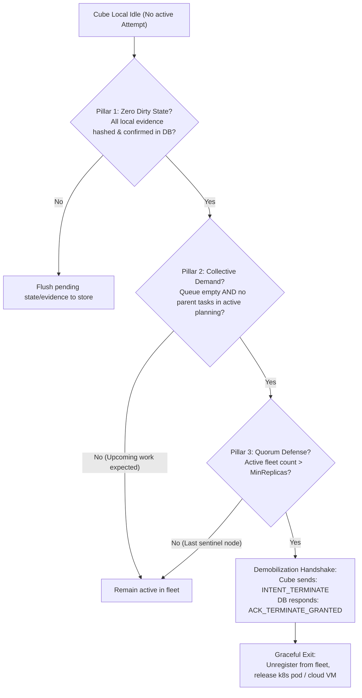

# Architecture: Dynamic Fleet Consensus — Role Specialization (Planner vs Workers) and Graceful Demobilization

**Status:** Proposed Architecture  
**Author:** SofiaFlux  
**Category:** Ideas / Orchestration  
**Related Discussions:** #136  

---

## 1. Problem & Context
In an autonomous, multi-node Collective, two operational challenges emerge:
1. **Dynamic Specialization:** How can Cubes collaborate efficiently on large missions without rigid, static server roles? Can one node dynamically coordinate and decompose work while others execute?
2. **Safe Scaling Down (Demobilization):** When should a dynamically spawned Cube terminate itself? Relying on a naive `idle > 15m` timer creates severe operational hazards (e.g., terminating right before a multi-stage plan yields child tasks, or premature killing of a node waiting for long compiler gates).

---

## 2. Dynamic Role Specialization: Lead Planner vs Swarm Workers

Rather than statically hardcoding "Planner Cubes" and "Worker Cubes", any available Cube can dynamically assume coordination leadership for an incoming mission:

### The Mechanism
1. **Plan Coordination Lease:** When a large backlog or new GitHub issue arrives, a free Cube leases the high-level planning task, becoming the **Lead Planner** for that task cycle.
2. **Work Fan-Out:** As the Planner decomposes the work into verifiable, bounded steps, it publishes them to the queue as independent child tasks (`CreateChildTask`).
3. **Swarm Execution:** Surrounding worker Cubes immediately claim these child tasks, running compiler verification, test suites, or code reviews in parallel.
4. **Synthesis:** The Lead Planner synthesizes the evidence and completes the overarching assessment.

---

## 3. The Fallacy of Naive Idle Timers
Terminating nodes based purely on an idle clock (e.g. `idle > 15m`) is unsafe in distributed agentic systems:
* A node might be idle because it is waiting on a slow integration test gate running on another node.
* A node might be idle moments before a Lead Planner emits a batch of 8 parallel tasks.
* Terminating without consensus can cause the fleet size to drop below quorum or the minimum replica count.

---

## 4. The 3-Pillar Demobilization Consensus Protocol

A Cube may only self-terminate when three explicit consensus conditions are satisfied:

### Pillar 1: Zero Dirty State Guarantee
A node cannot propose retirement while any local data buffer or working scratchpad has unverified or uncommitted evidence. Every attempt output must be recorded and confirmed by the relational store before demobilization begins.

### Pillar 2: Collective Demand & Pipeline Awareness
The node checks the state of the broader pipeline:
* Is the `ELIGIBLE` task queue empty?
* Are there active Lead Planners currently in turns 1–4 of a planning loop that will imminently produce child work?
If pending work is in the pipeline, idle nodes hold position rather than thrashing cloud compute up and down.

### Pillar 3: Quorum Defense & Minimum Replicas (`MinReplicas`)
The Collective's Constitution declares an inviolable minimum replica floor (e.g., `MinReplicas = 1` for local One-Man Army, `MinReplicas = 2` for high-availability enterprise clusters).
A node cannot terminate if its departure would reduce the fleet below this threshold. The last guardian never self-destructs.

### The Demobilization Handshake
1. The candidate Cube issues an atomic proposal:  
   `intent: "CUBE_DEMOBILIZE"`, `node_id: "cube-12"`.
2. The central database executes an atomic check: verifies the quorum floor, dereleases the node from the fleet registry, and returns `ACK_GRANTED`.
3. Upon receiving `ACK_GRANTED`, the node executes a clean shutdown (`os.Exit(0)`), signaling the infrastructure orchestrator to release the pod or VM.
