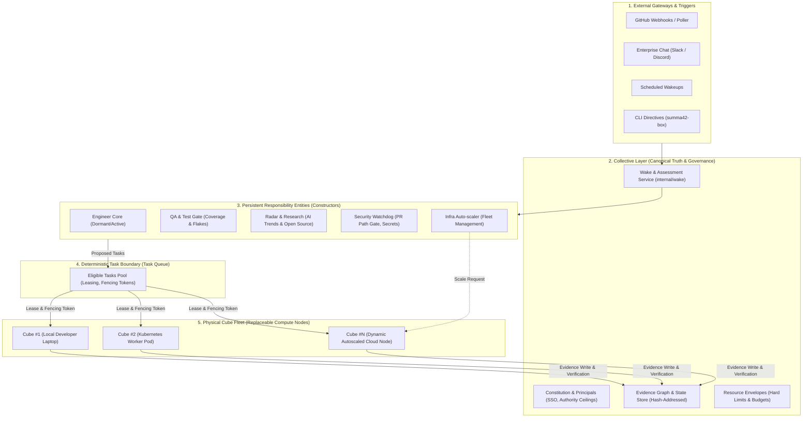

# Constructors & Collective Architecture in Summa42

## Core Architectural Principle

> **Constructors belong to the COLLECTIVE, not to any individual Cube.**  
> A **Cube** is a stateless, replaceable worker node (*Compute Node*) that leases tasks from the Collective's shared task queue under fencing tokens.

This fundamental separation allows the exact same Summa42 architecture to operate identically in:
1. **One-Man Army Mode:** 1 Collective + 1 local Cube process on a laptop, servicing all Constructors sequentially.
2. **Enterprise / Cloud-Native Mode:** 1 Collective + a fleet of $N$ Cubes (Kubernetes Pods, cloud VMs), servicing multiple teams (Engineers, QA, Marketing, Security).

---

## Architecture Diagram

---

## Multi-User & Enterprise Scope Resolution

In an organization with multiple teams (e.g. 10 engineers each having QA/Engineer constructors, marketing having research constructors):

### 1. Principal & Namespace Anchoring
A Constructor never possesses self-granted authority:
* Each Constructor has an `owner_principal_id` (the user or team who provisioned it).
* **Authority Ceiling Inheritance:** A Constructor's maximum permissions and resource envelopes are strictly bounded by those of its provisioning Principal. A junior developer cannot provision a Constructor with production deployment credentials.
* **Namespaced Identity:** Constructors are namespaced (`teams/billing/qa`, `teams/frontend/qa`, `usr_alice/dev`), eliminating name collisions across departments.

### 2. Multi-tier Constructor Classification
* **Personal:** Bound to a single developer (e.g. branch helper, personal scratchpad).
* **Team / Mission-Scoped:** Shared by a team (e.g. Billing QA, Infrastructure Manager).
* **Collective-Wide:** Global watchdogs (e.g. Compliance Watchdog, Security Auditor) owned by collective root administrators.

### 3. Failure Survival & Replaceability
* If a Cube node fails (OOMKilled, spot termination, network cut), **the Constructor does not die**.
* The Constructor's identity, responsibility, and history live in the Collective's state.
* The task lease in the scheduler expires safely, and another Cube node picks up the task without data corruption.

### 4. Autonomous Infrastructure Scaling
* A dedicated **Infrastructure Auto-scaler Constructor** monitors task queue backpressure.
* When backlog tasks accumulate beyond configured thresholds, it invokes authorized cloud capabilities to spin up pre-baked `summa42-cube:latest` containers in Kubernetes or cloud VMs.
* When idle for 15 minutes, ephemeral Cubes self-terminate to protect budget.

---

## Interactive Visualization
An interactive, pan-and-zoom SVG diagram of this architecture is available at:
[`docs/architecture/constructors-collective-architecture.html`](constructors-collective-architecture.html)
